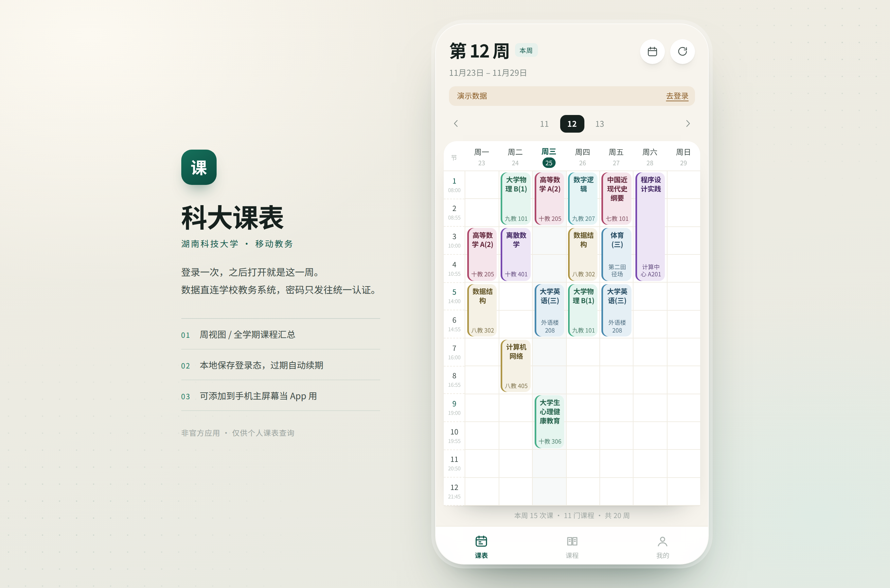
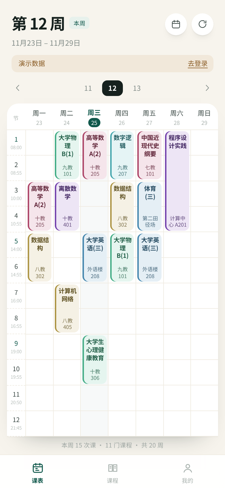

# 科大课表

湖南科技大学移动教务课表，本地运行。登录一次，之后打开就是这一周。



**直接安装**：[下载 keda-kebiao-v1.0.9.apk](https://github.com/Inkyiyo/keda-kebiao/releases/download/v1.0.9/keda-kebiao-v1.0.9.apk)（120 KB，Android 8.0+）· Android 端全部逻辑在本机完成，不需要电脑跑服务。



## 它能做什么

- **周视图课表**：8 列 × 12 节，课程按起止节次跨行，今天高亮，左右滑动或点箭头切周
- **课程详情**：点课程块看教师、教室、节次、周次
- **全学期课程汇总**：分批扫描 1–20 周，统计每门课出现多少周、都在哪几天上课
- **本地登录态**：教务 token 存在本机，过期自动用记住的密码续期，无需反复登录
- **可安装**：PWA，可添加到手机主屏，像 App 一样全屏打开
- **演示模式**：没有账号也能先看界面（示例课表）

## 快速开始

```bash
cd keda-kebiao
pip install -r requirements.txt
./run.sh                      # 打开 http://127.0.0.1:8765
```

想用手机访问（手机和电脑连同一个 Wi-Fi）：

```bash
HOST=0.0.0.0 ./run.sh
# 手机浏览器打开 http://<电脑局域网IP>:8765，再"添加到主屏幕"
```

> 教务系统只走 http 且需要校园网。校外请先连学校 VPN，否则登录能过、课表接口会超时。

## 安卓 APK

`科大课表.apk` 约 110 KB，支持 Android 8.0 及以上，已签名可直接安装。
界面与网页版完全一致，但登录、抓课表、课程汇总全部改由本机 Java 完成——不需要电脑开着服务，也不需要 Python。

装的时候系统会拦一次「未知来源应用」，允许后即可安装。

```bash
cd android
./build.sh            # 产物：out/科大课表.apk，只需 Android SDK，不需要 Gradle
```

签名密钥**不在仓库里**。首次构建前自己生成一个，之后一直用它（换了密钥签名不同，无法覆盖安装）：

```bash
keytool -genkeypair -keystore ../.secrets/kebiao.jks -alias kebiao -keyalg RSA \
  -keysize 2048 -validity 10000 -dname "CN=Keda Kebiao, OU=Personal, C=CN"
export HNUST_KS_PASS=<你设的口令>
./build.sh
```

`HNUST_KEYSTORE` 可以指向任意已有的 `.jks`。

## 登录链路

与官方 App 完全一致，不依赖任何第三方服务：

```
学号 + 密码
  → ① CAS 登录页取 execution
  → ② 密码 RSA(PKCS#1 v1.5) 加密，加 __RSA__ 前缀，POST /cas/login
  → ③ 关掉自动跳转，手动跟随 302：CAS → loginSso?ticket=… → 落地页
       token 依次从 地址栏 / Location / Set-Cookie / 响应体 里找，
       落地页若是 200 的中间页，会继续跟 script 或 meta 的软跳转（最多 12 跳）
  → ④ POST /Get_sjkbms 取默认作息模式 kbjcmsid
  → ⑤ POST /student/curriculum?week=&kbjcmsid=  拉整周课表（请求头 token）
  → ⑥ 结构化并渲染
```

几个已经踩过的坑，代码里都有对应处理：

| 坑 | 处理 |
| --- | --- |
| 密码必须加密，否则报"解密字符串时遇到异常" | `hnust.py: rsa_encrypt_password` |
| 门户 idToken 与教务 token 不互通 | 只走 CAS 跳转链抠 token，不用门户 token |
| `/student/curriculum` 与 `getSycurriculum` 长得一样 | 只用前者，后者永远返回空课表 |
| 证书链缺中间证书，certifi 校验失败 | 优先用系统 CA 库，`HNUST_CA_BUNDLE` 可覆盖 |
| 验证码是失败升级措施 | 连续失败 3 次自动弹验证码，图片直传给前端 |
| 教务 token 过期返回 401 | 清 token → 用记住的密码自动重登一次 → 重试 |

完整的 17 条踩坑记录（现象 / 真因 / 怎么定位出来的）见 **[docs/踩坑记录.md](docs/踩坑记录.md)**，按「拿包 → 登录 → 找服务 → 认证 → 调接口 → 界面 → 流程」七个阶段分组。

其中最贵的三个：

- **密码明文必失败**：服务端先剥前 7 字符 `__RSA__` 再解密，发明文等于把密码前 7 位吃掉。
- **门户 idToken 与教务 token 不互通**：教务 token 只出现在 CAS 跳转落地页的 URL 里，随后被页面写进 `sessionStorage`。
- **`getSycurriculum` 与 `curriculum` 参数完全相同**：用错前者，症状是登录成功、周次正确、课表全空。

## 诊断日志

登录出问题时，先导日志再猜：

| 版本 | 操作 | 结果 |
| --- | --- | --- |
| APK | 登录页底部「登录不上？导出诊断日志」，或「我的」→ 导出诊断日志 | 写文件 + 复制到剪贴板 + 调起系统分享 |
| 网页版 | 同上，或直接访问 `/api/logs` | 打开纯文本日志页 |

日志记的是**流程和状态码**，不是内容：每次 HTTP 的方法、URL、状态码、字节数、耗时，加上登录各阶段（取 execution、加密长度、CAS 返回码、跳了几跳、有没有拿到 token、页面原文提示）。密码、token、ticket、execution 和学号后 6 位在写入时就已打码，导出前不依赖调用方自觉。

一次失败的登录大概长这样（样例见 `docs/诊断日志样例.txt`）：

```
[18:42:57.020] S 拿到 execution（12957 字符）
[18:42:57.246] S 密码已加密，密文 351 字符
[18:42:57.525] H POST https://cas-i.hnust.edu.cn/cas/login?service=... -> 401 (134186B, 276ms)
[18:42:57.533] E 登录被拒，页面提示：账号或密码错误，需验证码=false
[18:42:57.897] H POST .../passwordLogin?username=0000******&password=*** -> 401 (153B, 362ms)
```

看 `需验证码=false` 和最后那条 `passwordLogin 401`，就能直接判断是密码不对、还是被风控挡了。

## 目录

```
keda-kebiao/
├── server.py               FastAPI：登录、课表、课程汇总、日志、静态资源
├── hnust.py                教务客户端：RSA、CAS、token、课表解析
├── logs.py                 网页版诊断日志（环形缓冲 + 脱敏）
├── demo.py                 演示课表数据
├── run.sh                  启动脚本
├── docs/                   截图与《踩坑记录.md》
├── data/                   本机状态（token、加密后的密码），不进版本库
├── static/                 前端（原生 JS，无构建步骤）
│   ├── index.html
│   ├── styles.css
│   ├── app.js
│   ├── native-shim.js      App 内把 /api/* 转给原生实现的桥接层
│   ├── manifest.webmanifest
│   └── sw.js
└── android/                安卓工程（手写构建，不依赖 Gradle）
    ├── build.sh            aapt2 → javac → d8 → zipalign → apksigner
    ├── app/src/main/java/cn/kebiao/hnust/
    │   ├── MainActivity.java   WebView 容器 + JS 桥
    │   ├── Api.java            复刻网页版的所有 /api/* 接口
    │   ├── HnustClient.java    CAS 登录与课表解析（与 hnust.py 等价）
    │   ├── Store.java          登录态，密码用 Android Keystore 加密
    │   ├── Diag.java           诊断日志（脱敏、滚动写盘）
    │   ├── DiagProvider.java   把日志文件交给分享面板
    │   └── Base64Codec.java
    └── app/src/main/assets/    构建时同步自 static/
```

## 接口

| 方法 | 路径 | 说明 |
| --- | --- | --- |
| GET | `/api/status` | 登录状态、校区、当前周 |
| POST | `/api/login` | `{username, password, campus, remember, captcha?, cid?}` |
| POST | `/api/logout` | 清除本机登录态 |
| POST | `/api/demo` | 进入演示模式 |
| GET | `/api/curriculum?week=12` | 整周课表；`week` 省略＝当前周 |
| GET | `/api/courses?start=1&end=20&limit=4` | 分批汇总课程，返回 `next` / `done` |
| GET | `/api/logs` | 诊断日志（纯文本，已脱敏） |
| POST | `/api/settings` | `{totalWeeks: 20}` |

## 数据与隐私

- 账号密码只提交到 `cas-i.hnust.edu.cn`，不经过任何第三方
- 网页版：「记住登录状态」把密码用本机随机密钥（`data/.key`，权限 600）加密后存在 `data/state.json`
- APK：「记住登录状态」把密码交给 Android Keystore 里的 AES 密钥加密，密钥不出系统安全区
- 课表与 token 只存在本机，服务默认只监听 `127.0.0.1`
- `HOST=0.0.0.0` 会把服务暴露到局域网，请只在可信网络下这样用

## 已知限制

- **总周数**默认 20 周，学校教务接口不返回校历，可在「我的」里手动调整
- **作息时间**优先从 `Get_sjkbms` 里读，读不到时用常见作息（8:00 起，12 节）
- **潇湘学院**走 `xxfw.hnust.edu.cn`，接口结构相同，未实测
- 课表接口有缓存（4 分钟），下拉刷新按钮会强制重取
- APK 与网页版一样，**课表接口只走校内 http**：不在校园网时请先连学校 VPN

## 排错

| 现象 | 原因 |
| --- | --- |
| 提示"账号或密码错误" | CAS 明确回 200 且带错误提示，才是密码错或账号未开通 |
| 提示"统一认证已通过……没交出 token" | 密码是对的（CAS 已签发 302 票据），卡在教务 SSO 落地页；把诊断日志发我，按落地页结构适配 |
| 提示"账号密码正确，但教务系统拒绝登录" | 连续失败触发了验证码或临时锁定，等 10 分钟；仍不行请改用网页登录 |
| 提示"登录状态已过期" | token 失效且没有记住密码，重新登录即可 |
| 课表空白但登录成功 | 检查是否走错校区（本部 / 潇湘） |
| 一直停在"正在取课表" | 校外未连 VPN，`kdfw.hnust.edu.cn` 不通 |
| 其他说不清的问题 | 先导出诊断日志，里面能看出停在哪一步、服务端到底回了什么 |

---

非官方应用，仅供个人课表查询。界面与逻辑参考 `科大课表获取课表原理说明.md`。
